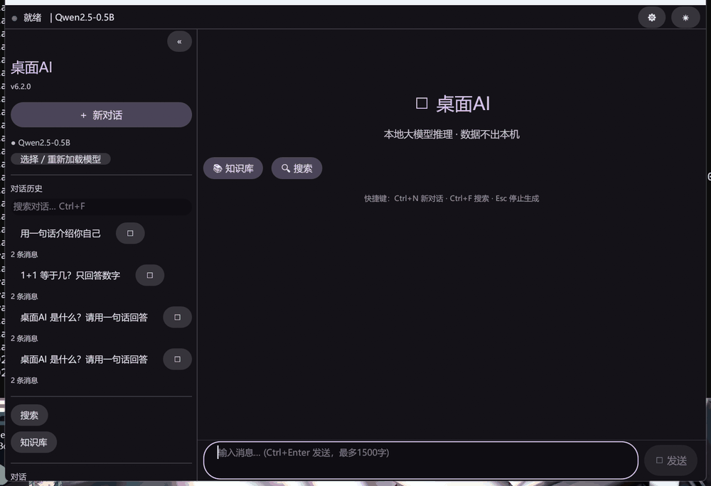
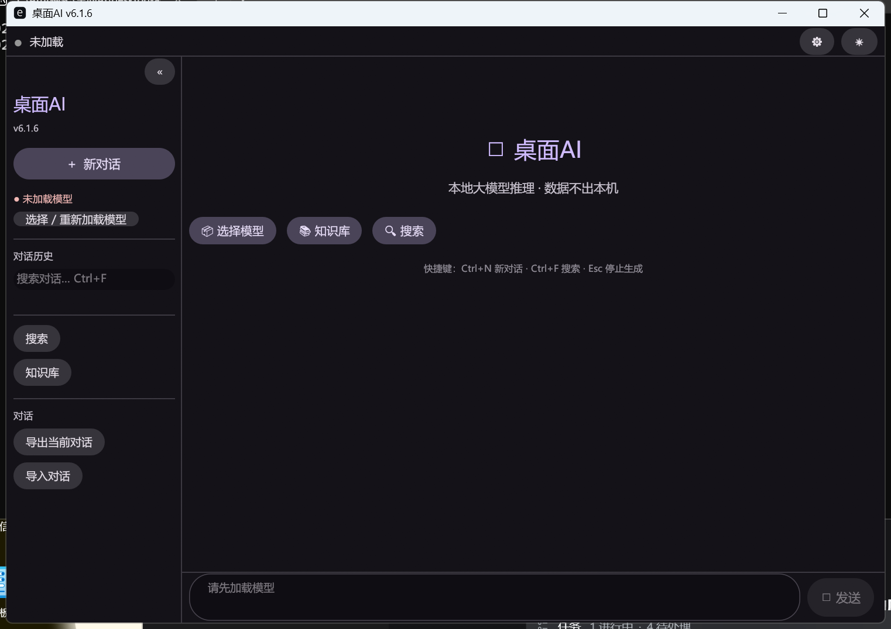
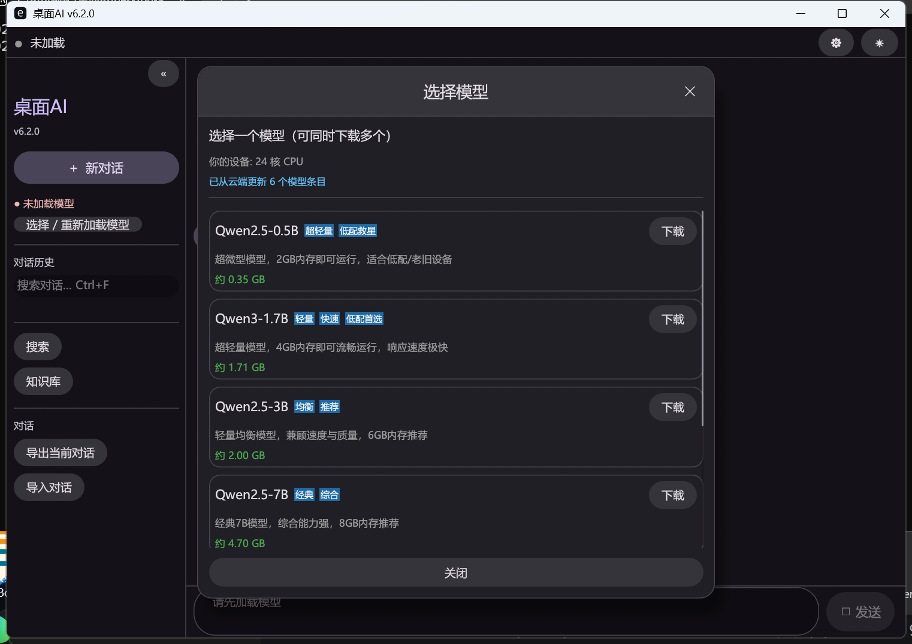
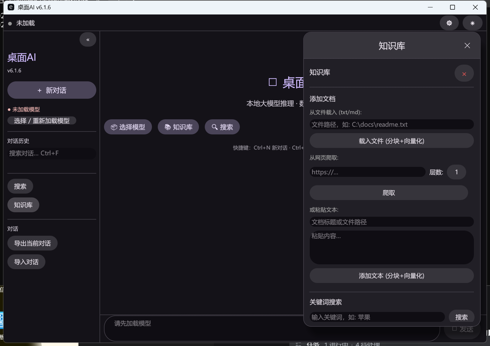

<div align="center">

# 桌面AI

**纯 Rust 打造的本地大模型聊天应用 —— 双击即用，数据不出本机**

无需 Python / Node / CUDA / Docker，一个 exe 就是全部

[](./README_EN.md)

[](https://github.com/96312-reneren/desktop-ai/releases)
[](https://github.com/96312-reneren/desktop-ai/actions)
[](./desktop-ai/LICENSE)
[](https://github.com/96312-reneren/desktop-ai/releases)
[](https://www.rust-lang.org/)



</div>

---

## 为什么用它？

| 开箱即用 | 完全本地 | 不止聊天 |
| --- | --- | --- |
| 下载解压双击运行<br>全程 GUI 零命令行 | 模型、对话、知识库全在本机<br>断网也能用 | RAG 知识库 + 联网搜索<br>+ 网页爬虫 + OpenAI 兼容 API |

- **纯 Rust 实现**：egui 界面 + llama.cpp 推理，内存占用小，启动飞快
- **6 款 Qwen 模型内置目录**：0.5B ~ 8B，覆盖 2 GB – 16 GB 内存设备，自动检测硬件推荐型号，下载支持断点续传
- **RAG 混合检索**：向量语义 + FTS5 关键词双路召回（RRF 融合去重），附查询重写（指代消解），来源类型一目了然（粘贴 / 文件 / 抓取）
- **联网增强**：DuckDuckGo 搜索 + 深度网页爬虫（SSRF 防护拉满）
- **OpenAI 兼容 API**：`/v1/chat/completions`，任何 OpenAI 客户端即插即用
- **GPU 加速**：CUDA / Vulkan 自动检测
- **SQLite 存储**：WAL 事务、增量落盘，崩溃不丢对话
- **安全加固**：红队回归测试、ChatML 注入消毒、下载 SHA-256 校验
- **254 项自动化测试全绿，Clippy 零警告**

## 界面一览

| 主界面（欢迎页） | 模型选择（自动硬件推荐） | 知识库面板（三种入库方式） |
| --- | --- | --- |
|  |  |  |

## 三分钟上手

1. 从 [Releases](https://github.com/96312-reneren/desktop-ai/releases) 下载对应平台压缩包
   - **Windows**：`桌面AI.exe` 与 `llama.dll` 放同一文件夹，双击运行
   - **Linux**：解压 tar.gz 运行 `desktop-ai`（需 glibc ≥ 2.35，Ubuntu 22.04+）
2. 点击「选择模型」→ 挑一个适合你内存的型号（小内存选 0.5B / 1.7B）→ 等待下载
3. 输入问题，Ctrl+Enter 发送 —— 完成

> 想用知识库 / 联网搜索？设置面板一键开启；想接入自己的程序？设置里开 API 服务，端口默认 11434。

## 命令行启动服务（可选）

不想挂窗口、只把 DesktopAI 当本地模型后端（Chatbox / Continue / Cline / 沉浸式翻译等客户端）时：

```powershell
桌面AI.exe serve                                    # 加载配置里选中的模型
桌面AI.exe serve --model qwen2.5-0.5b --port 8321   # 指定模型与端口
桌面AI.exe serve --model D:\models\qwen3-8b.gguf --gpu-layers 99
```

启动后终端打印 API 地址与 token；没有控制台时（例如脚本无窗口拉起），同样的信息写入数据目录的 `serve.info`。

```bash
curl http://127.0.0.1:8321/v1/models -H "Authorization: Bearer da-xxxx"
```

> 该模式只做纯对话补全（不含 RAG 知识库与联网搜索）；需要知识库请用图形界面。`桌面AI.exe --help` 查看全部参数。

## 仓库内容（单一 main 分支）

| 目录 | 内容 |
| ---- | ---- |
| [`desktop-ai/`](./desktop-ai/) | 桌面版（Windows / Linux）：egui 界面 + llama.cpp 推理 + RAG 知识库 —— **详细文档见 [desktop-ai/README.md](./desktop-ai/README.md)** |
| [`android/`](./android/) | 安卓混合架构版：Kotlin Activity + Rust .so（JNI）+ WebView 聊天界面 |
| [`vendor/`](./vendor/) | 第三方运行时库（llama.cpp 的 DLL），见 [vendor/README.md](./vendor/README.md) |
| `.github/` | CI 与发布工作流：push 构建双平台产物，打 tag 自动发 Release |

## 技术栈

`Rust` · `egui` · `llama.cpp (GGUF)` · `SQLite (WAL + FTS5)` · `reqwest` · `pulldown-cmark` · `Kotlin + JNI (Android)`

## 开源许可

应用代码采用 [MIT 许可证](./desktop-ai/LICENSE)；llama.cpp 为 MIT；Qwen 模型为 Apache 2.0（阿里云/通义）。

---

<div align="center">

如果这个项目对你有帮助，欢迎 Star。

</div>
