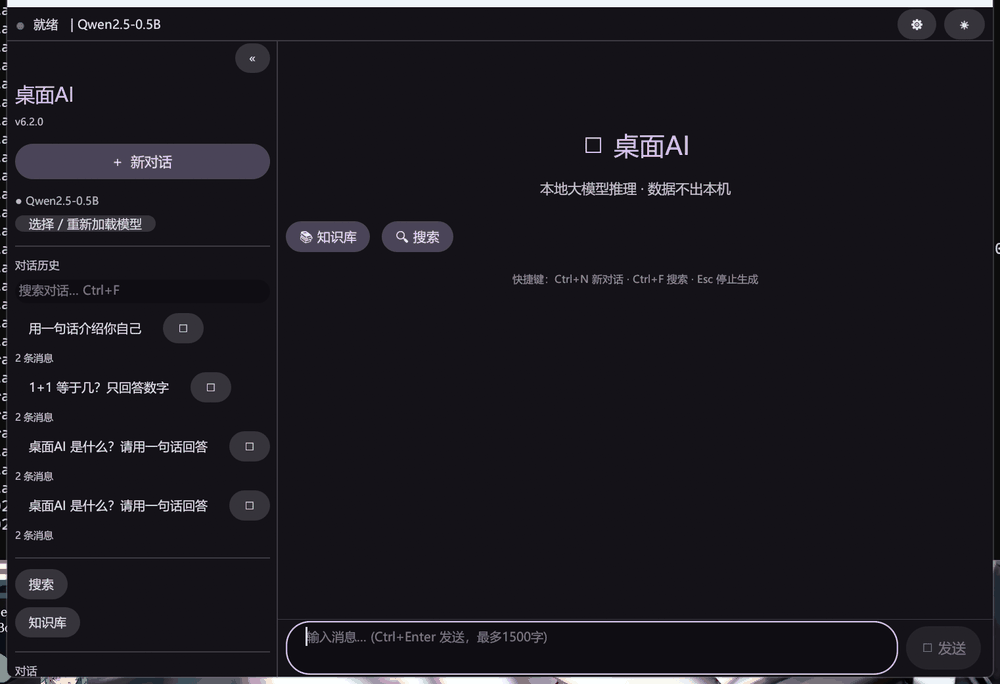
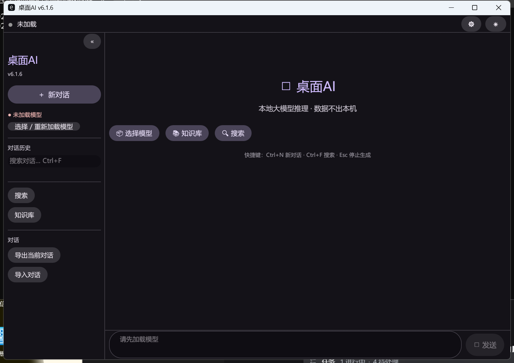
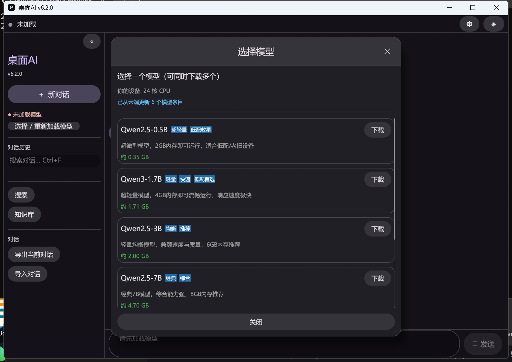
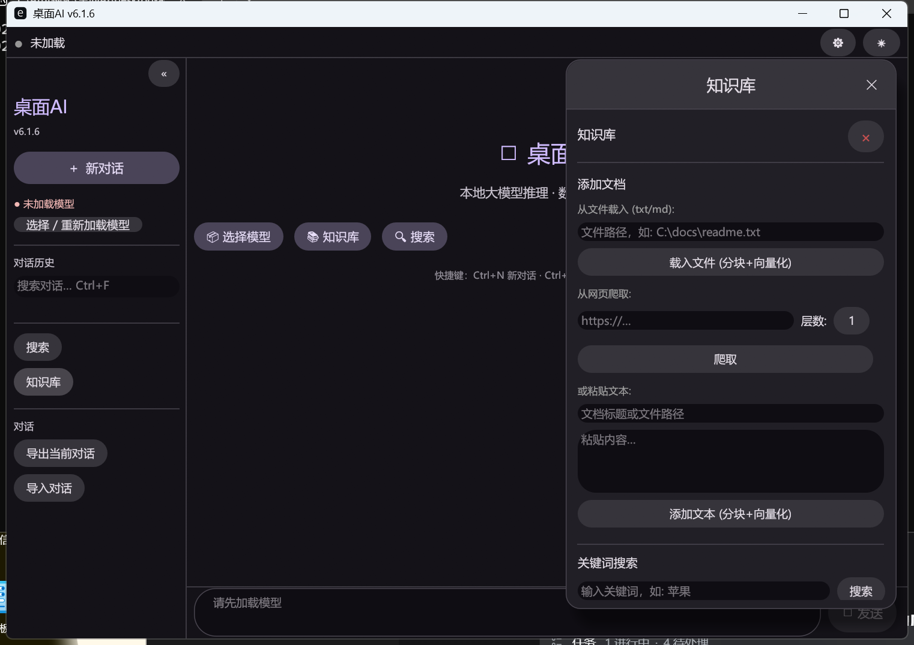

# DesktopAI

**A local-LLM chat app in pure Rust — double-click and go, your data never leaves your machine**

No Python / Node / CUDA / Docker required. One exe is all you need.

---

## Why DesktopAI?

| Zero setup | Fully local | More than chat |
| --- | --- | --- |
| Download, unzip, double-click. Pure GUI — no command line. | Models, chats and knowledge base all stay on your machine. Works offline. | RAG knowledge base + web search + web crawler + OpenAI-compatible API |

- **Pure Rust**: egui UI + llama.cpp inference. Small memory footprint, instant startup
- **6 built-in Qwen model profiles**: 0.5B–8B, covering 2 GB–16 GB RAM devices; auto hardware detection recommends a fit; downloads support resume
- **Hybrid RAG retrieval**: vector semantics + FTS5 keyword dual recall (RRF fusion & dedup), rule-based query rewriting (coreference resolution), source badges (paste / file / crawl)
- **Web-augmented**: DuckDuckGo search + deep web crawler (full SSRF hardening)
- **OpenAI-compatible API**: `/v1/chat/completions` — plug in any OpenAI client
- **GPU acceleration**: CUDA / Vulkan auto-detected
- **SQLite storage**: WAL transactions, incremental persistence — crashes never lose chats
- **Security-hardened**: red-team regression tests, ChatML injection sanitization, SHA-256 verified downloads
- **254 automated tests green, zero Clippy warnings**

## Screenshots

| Main window | Model picker (hardware-aware) | Knowledge base panel (3 ingest paths) |
| --- | --- | --- |
|  |  |  |

## Get started in 3 minutes

1. Grab the archive for your platform from [Releases](https://github.com/96312-reneren/desktop-ai/releases)
   - **Windows**: put `桌面AI.exe` and `llama.dll` in the same folder, double-click
   - **Linux**: untar and run `desktop-ai` (glibc ≥ 2.35, Ubuntu 22.04+)
2. Click **选择模型 (Pick a model)** → choose a size that fits your RAM (0.5B / 1.7B for small machines) → wait for the download
3. Type a question, Ctrl+Enter to send — done

> Want the knowledge base / web search? Toggle them in the settings panel. Want to drive it from your own program? Enable the API server in settings — default port 11434.

## Repository layout (single main branch)

| Directory | Contents |
| ---- | ---- |
| [`desktop-ai/`](./desktop-ai/) | Desktop app (Windows / Linux): egui UI + llama.cpp inference + RAG knowledge base — **full docs in [desktop-ai/README.md](./desktop-ai/README.md)** (Chinese) |
| [`android/`](./android/) | Android hybrid build: Kotlin Activity + Rust .so (JNI) + WebView chat UI |
| [`vendor/`](./vendor/) | Third-party runtime libraries (llama.cpp DLLs), see [vendor/README.md](./vendor/README.md) |
| `.github/` | CI & release workflows: pushes build both platforms, tags auto-publish Releases |

## Tech stack

`Rust` · `egui` · `llama.cpp (GGUF)` · `SQLite (WAL + FTS5)` · `reqwest` · `pulldown-cmark` · `Kotlin + JNI (Android)`

## License

Application code is [MIT](./desktop-ai/LICENSE); llama.cpp is MIT; Qwen models are Apache 2.0 (Alibaba Cloud / Tongyi).

---

If this project helps you, a Star means a lot.

